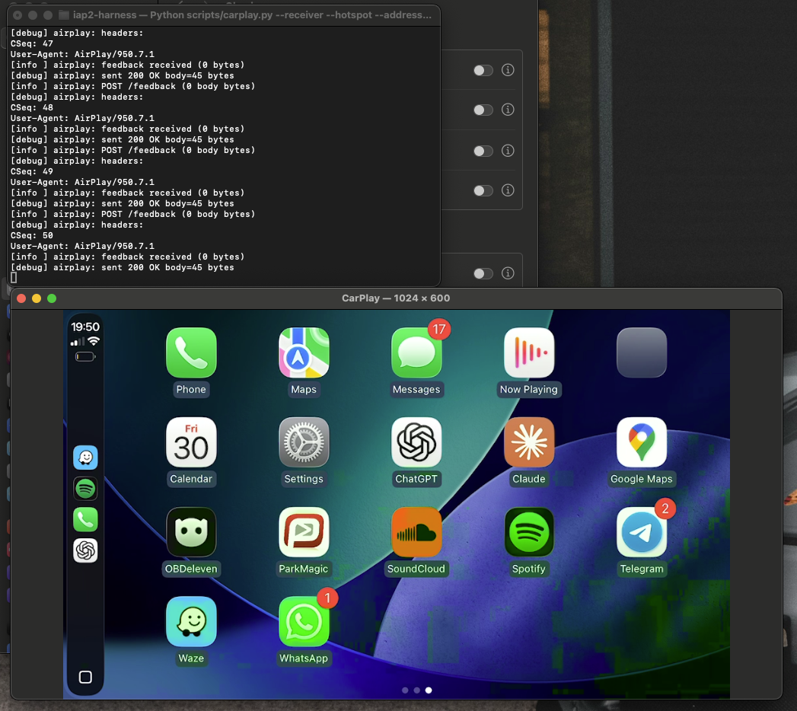

# iap2-harness

An experimental macOS wireless CarPlay receiver with a native video window.
Live iPhone video was confirmed on 30 October 2026 using a Mac-hosted Wi-Fi
hotspot and an outgoing Bluetooth iAP2 connection.



*Actual live session on macOS, 30 October 2026. The terminal shows the encrypted
AirPlay control session alongside the CarPlay app grid.*

Verified: Bluetooth link, MFi authentication, accessory identification, Wi-Fi
handoff, AirPlay pairing and encrypted control, H.264 receive/decode/display.
Audio and touch are implemented but were not validated in this live session.

## Platform selection and image quality

The current refactor separates the protocol engine from video, PCM audio and
input backends. macOS remains the working native implementation. A headless
backend and a custom-backend build hook are available for port development;
Pi/Linux and QNX native hardware adapters are not implemented yet.
See [the porting guide](docs/PORTING.md) for build switches and the backend API.

The video pipeline now parses NAL lengths explicitly and preserves decoder
state across duplicate codec configuration. This addresses a framing bug that
could cause blocky corruption. High-resolution display settings are optional;
the default stays 1024×600. The test user reported cleaner output after a live restart on 31 October 2026.

## Requirements

- macOS, Xcode Command Line Tools, Swift, CMake, Python 3 and Homebrew.
- An iPhone with CarPlay enabled and Bluetooth/Wi-Fi turned on.
- Your own compatible MFi certificate bundle and matching private key.
  Credentials are not included. Store them outside this checkout.
- For a Mac-hosted hotspot: a live Ethernet upstream and Internet Sharing to Wi-Fi.
  A Raspberry Pi sharing its Wi-Fi connection over Ethernet was used in testing.

## Build from a fresh clone

```sh
git clone https://github.com/Rorycox21/iap2-harness.git
cd iap2-harness
brew install cmake pkg-config openssl mbedtls@3 libusb
cmake -S . -B build \
  -DCMAKE_PREFIX_PATH="$(brew --prefix mbedtls@3);$(brew --prefix openssl)" \
  -DMbedTLS_DIR="$(brew --prefix mbedtls@3)/lib/cmake/MbedTLS"
cmake --build build -j 4
ctest --test-dir build --output-on-failure
```

The macOS build creates `build/iap2-harness`, the patched `build/bt-bridge`
and the experimental incoming `build/bt-accessory`. The working outgoing
bridge is included; a separate PlayPort checkout is not required.

## Set up the Mac hotspot

1. Connect Ethernet to a router or the Pi. Set that Mac network service to DHCP
   and confirm it has an address and router.
2. Open **System Settings → General → Sharing → Internet Sharing**.
3. Share the Ethernet connection **to Wi-Fi**. In Wi-Fi Options, choose a name
   such as `MacCarPlay`, a fixed channel and WPA2/WPA3 Personal. Set the password
   yourself in macOS. Enable Internet Sharing.
4. Verify the actual access point:

```sh
python3 scripts/mac_hotspot.py
```

The verified test configuration used channel 11 and `192.168.2.1`, but use the
reported address/channel on your Mac. An enabled sharing switch alone does
not prove that the access point is broadcasting. Hotspot mode checks an
already running system hotspot; it does not toggle Internet Sharing for you.

For the optional Pi upstream setup, see [Pi Ethernet sharing](docs/PI-UPLINK.md).

## Start with a new iPhone

1. Keep the iPhone unlocked with **Settings → Bluetooth** open. Find its Bluetooth
   address using the scan helper (or Settings → General → About → Bluetooth).
   Allow Bluetooth access for your terminal if macOS asks:

```sh
./build/bt-bridge --scan
```

2. Start the receiver, replacing the address and credential paths:

```sh
python3 scripts/carplay.py --receiver --hotspot \
  --address AA:BB:CC:DD:EE:FF \
  --mfi-cert /absolute/path/to/certificate.p7b \
  --mfi-key /absolute/path/to/identity.pk8
```

The terminal asks for the **existing hotspot password with input hidden**.
It detects this Mac's Bluetooth address and the hotspot's actual IP/channel.
`CARPLAY_WIFI_PASSPHRASE` can supply the password instead; avoid placing a real
password in a command that will be saved to shell history.

If the phone is not bonded, the launcher builds and opens Apple's native
pairing app. Select the intended iPhone and accept matching codes. If the Mac
does not list the phone, keep the Mac's Bluetooth settings and pairing dialog
open, then select the Mac under **Other Devices** on the iPhone. This route
established the test bond. The helper app exits after the pairing dialog so
it does not keep scanning during receiver startup.

Accept **Use CarPlay** on the iPhone when offered. The Bluetooth protocol
sends the hotspot invitation; video then uses Wi-Fi. The Mac window initially
says it is waiting for video and updates when decoded frames arrive.

For subsequent runs, use the same command and credentials. The saved Bluetooth
bond and local AirPlay trust state are reused. Switching iPhones requires the
new phone's address and its own pairing/CarPlay approval; you do not need to
remove the previous phone's pairing.

## Diagnostics and stopping

- CLI numeric pairing (`--cli-pair`) returned `0x1f` in testing; the native
  pairing controller is the demonstrated successful route.
- If logs report `OI_RFCOMM_Connect` status 911, an earlier channel may still
  exist. Close the old receiver first. An iPhone Bluetooth off/on cycle cleared
  this condition in testing without removing the saved bond.
- Do not pipe `bt-bridge` into `--capture --address`: that mode already creates
  a full-duplex child bridge. Capture collects traffic; it does not start video.
- Close diagnostic Safari tabs pointed at the receiver before a CarPlay test.
- Close the receiver window or press Ctrl-C in its terminal to stop it. The
  launcher cleans up its own bridge and Bonjour child processes. Close an older
  manually launched receiver before starting another. Internet Sharing stays
  enabled until you turn it off.

AirPlay identity/controller trust is stored under the user's Application
Support directory. `CARPLAY_PAIRING_FILE` overrides it. Keep that file private.

## Screenshots and publication

The screenshot above is an actual capture supplied from the working session.
See [screenshot capture instructions](docs/screenshots/README.md) for additional
window-only captures. No mockups are presented as live output.
Credentials, local trust files, packet captures, logs and build outputs are
excluded from version control. Review screenshot content before publishing.

## References and implementation history

- [Current validation and project status](STATUS.md)
- [Earlier development notes](docs/DEVELOPMENT.md)
- [PlayPort bridge attribution and licence](third_party/playport-bt-bridge/README.md)
- [Apple wireless CarPlay architecture](https://developer.apple.com/videos/play/wwdc2017/717/)
